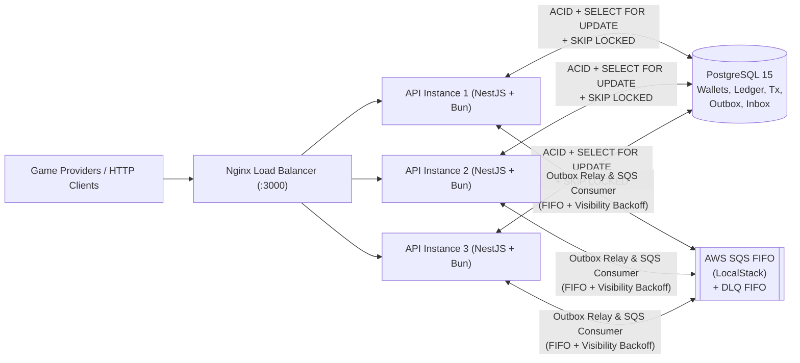

# Architecture & Technical Decisions

Este documento descreve em profundidade as decisões arquiteturais, garantias formais de concorrência, idempotência persistente, consistência financeira, estratégia de mensageria assíncrona (Inbox/Outbox + SQS FIFO + DLQ), observabilidade e trade-offs do **Distributed Wagering Processor**.

---

## 1. Visão Geral da Arquitetura

O sistema foi projetado sob os princípios de **Domain-Driven Design (DDD)**, **Clean/Hexagonal Architecture (Ports & Adapters)** e **Event-Driven Architecture**, suportando **execução multi-instância real** (3 réplicas stateless `api-1`, `api-2`, `api-3` balanceadas via Nginx na porta `3000`).

### Camadas do Sistema
- **Domain (`src/domain`):** Totalmente puro e livre de dependências de framework. Contém o Value Object imutável `Money` (`big.js`), os agregados e entidades (`Wallet`, `WalletLedgerEntry`, `WagerTransaction`, `OutboxMessage`, `InboxMessage`), eventos de domínio e `DomainException` categorizada (`VALIDATION`, `NOT_FOUND`, `CONFLICT`, `BUSINESS_RULE`, `TRANSIENT_INFRA`).
- **Application (`src/application`):** Orquestra casos de uso transacionais (`ProcessWagerTransactionUseCase`, `CreateWalletUseCase`, `ReconcileWalletUseCase`, `GetWalletUseCase`, `GetWalletLedgerUseCase`, `GetWagerTransactionUseCase`) e define portas (`WalletRepositoryPort`, `WagerTransactionRepositoryPort`, `OutboxRepositoryPort`, `InboxRepositoryPort`, `UnitOfWorkPort`, `MessagePublisherPort`).
- **Infrastructure (`src/infrastructure`):** Implementa persistência via **MikroORM v7** sobre PostgreSQL 15, migrations versionadas e reversíveis com constraints e triggers `append-only`, consumidor SQS FIFO (`WagerSqsConsumer`), publicador Outbox (`OutboxPublisher` / `OutboxRelayWorker`), reconciliador assíncrono (`PendingReferenceWorker`) e telemetria (`MetricsService`, `JsonLoggerService`, `RequestContext` com `AsyncLocalStorage`).
- **Presentation (`src/presentation`):** Controllers REST (`WalletController`, `WagerController`, `HealthController`), validação rigorosa via `ValidationPipe` (`whitelist: true`, `forbidNonWhitelisted: true`), guard de identidade extensível (`ProviderAuthGuard`) e mapeamento semântico de status HTTP (`DomainExceptionFilter`).

---

## 2. Stack Tecnológica e Justificativas

| Componente | Escolha | Justificativa Técnica |
|---|---|---|
| **Runtime & Test Runner** | **Bun 1.x** | Baixíssimo overhead de inicialização, execução nativa de TypeScript em `strict: true` e runner de testes de alta performance. |
| **Framework** | **NestJS 10** | Modularidade, ciclo de vida estruturado (`OnModuleInit` / `OnModuleDestroy` para graceful shutdown) e injeção de dependência desacoplada por símbolos de porta. |
| **ORM** | **MikroORM v7 (`@mikro-orm/postgresql`)** | Implementação explícita de *Unit of Work*, *Identity Map* isolado por `em.fork()`, suporte nativo a `LockMode.PESSIMISTIC_WRITE` (`SELECT ... FOR UPDATE`) e `LockMode.PESSIMISTIC_PARTIAL_WRITE` (`SELECT ... FOR UPDATE SKIP LOCKED`). |
| **Banco de Dados** | **PostgreSQL 15** | Garantias ACID, constraints `CHECK`, `FOREIGN KEY`, `UNIQUE` compostos e trigger `BEFORE UPDATE OR DELETE` para imutabilidade física do ledger. |
| **Mensageria** | **AWS SQS FIFO (LocalStack)** | Particionamento ordenado por `MessageGroupId` (`walletId`) combinado com fila Dead Letter Queue (`wager-transactions-dlq.fifo`). |

---

## 3. Modelo Monetário e Garantias de Schema (PostgreSQL)

### 3.1 Mapeamento do `Money` Value Object
- Nenhum valor financeiro utiliza `number`, `float` ou `double` em nenhuma camada.
- O Value Object `Money` encapsula `big.js` com escala fixa de **2 casas decimais**, rejeitando números nativos, notação científica (`1e5`), `NaN`, `Infinity`, valores negativos na entrada externa e códigos de moeda fora do padrão ISO-4217 (3 letras maiúsculas).
- No PostgreSQL, todos os valores monetários são persistidos como `NUMERIC(19, 2)` acompanhados de coluna `currency VARCHAR(3)`.

### 3.2 Garantias Físicas no Schema (`Migration20261029163215_InitSchema`)
Todas as invariantes da Seção 6 são reforçadas diretamente no PostgreSQL:
1. **`wallets`:**
   - `UNIQUE (player_id, currency)`
   - `CHECK (balance >= 0)` e `CHECK (version >= 1)`
2. **`wager_transactions`:**
   - `FOREIGN KEY (wallet_id) REFERENCES wallets(id)`
   - `UNIQUE (provider_id, external_transaction_id)`
   - `UNIQUE (idempotency_key)`
   - `CHECK (amount >= 0)`
   - Índices compostos para workers e reconciliação: `(status, created_at)` e `(provider_id, reference_external_transaction_id)`.
3. **`wallet_ledger_entries`:**
   - `FOREIGN KEY (wallet_id) REFERENCES wallets(id)` e `FOREIGN KEY (transaction_id) REFERENCES wager_transactions(id)`
   - `UNIQUE (transaction_id)` (1 lançamento por transação que altera saldo)
   - `CHECK (amount >= 0)` e `CHECK (balance_after >= 0)`
   - **Trigger Append-Only (`trg_wallet_ledger_entries_append_only`):** Bloqueia fisicamente qualquer comando `UPDATE` ou `DELETE` na tabela `wallet_ledger_entries`.
   - Índice composto `(wallet_id, created_at DESC, id DESC)` para paginação keyset determinística.
4. **`outbox_messages` & `inbox_messages`:**
   - Índice parcial `idx_outbox_messages_pending` (`WHERE published_at IS NULL`) para varredura rápida.
   - `UNIQUE (consumer_name, message_id)` na `inbox_messages`.

---

## 4. Estratégia de Controle de Concorrência

### 4.1 Lock Pessimista por Carteira (`SELECT ... FOR UPDATE`)
Em um processador de apostas (*hot wallet*), dezenas de operações simultâneas podem atingir a mesma carteira em milissegundos.
- **Por que Lock Pessimista em vez de Lock Otimista?** O lock otimista (`WHERE version = ?`) faz com que 49 de 50 transações concorrentes na mesma carteira falhem com erro de versão, exigindo loops de retry caros na aplicação. Já o lock pessimista a nível de linha (`LockMode.PESSIMISTIC_WRITE` em `findByIdForUpdate(walletId)`) serializa no próprio kernel do PostgreSQL apenas as transações que competem pelo **mesmo `walletId`**, enquanto carteiras distintas são processadas em total paralelismo (Zero Global Lock — Regra 6 da Seção 5).

### 4.2 Serialização Pós-Lock para Idempotência Concorrente (Cenário 13.1)
Quando 50 requisições idênticas (mesma `Idempotency-Key`) chegam exatamente ao mesmo tempo em múltiplas instâncias:
1. Um *fast-path* antes da transação retorna imediatamente caso a transação já esteja comitada em estado terminal.
2. Caso ainda não exista (ou esteja em andamento), o caso de uso abre a transação SQL e **adquire primeiro o lock pessimista da carteira (`SELECT ... FOR UPDATE`)**.
3. **Imediatamente após adquirir o lock da carteira**, o caso de uso **re-verifica** `findByIdempotencyKey` e `findByProviderAndExternalId` dentro da transação.
4. Assim, a 1ª requisição processa o débito e comita; as 49 requisições seguintes, ao saírem da fila do `FOR UPDATE`, enxergam a transação recém-comitada e retornam `200 OK` com `idempotentReplay: true` e o saldo histórico exato observado no lançamento original (Regra 7 da Seção 8), sem estourar `23505 UniqueConstraintViolationException`.
5. Caso uma mesma `Idempotency-Key` seja enviada concorrentemente apontando para `walletId`s distintos, um bloco `catch` trata o código SQL `23505` fazendo fallback para a leitura pós-conflito e validação de `payloadHash`.

---

## 5. Desenho de Idempotência Persistente

- Nenhuma estrutura em memória é usada para idempotência.
- Toda operação calcula um `payloadHash` SHA-256 sobre uma representação JSON canônica profunda (incluindo `money.amount`, `money.currency`, `kind`, `roundId`, `gameId`, `playerId`, `walletId`, `providerId`, `externalTransactionId`, `referenceExternalTransactionId`).
- Se a chave já existir com **mesmo `payloadHash`**: retorna o estado original (`idempotentReplay: true`) e, para transações `PROCESSED`, recupera via `findLedgerEntryByTransactionId` (O(1)) o `balanceAfter` exato registrado naquele lançamento histórico.
- Se a chave já existir com **`payloadHash` divergente**: lança `DomainException.conflict("...", FailureCode.PayloadMismatch)` mapeado para `409 Conflict`.

---

## 6. Estratégia de Transactional Outbox e Inbox Pattern

### 6.1 Transactional Outbox (`outbox_messages`)
- Nenhum evento é publicado no broker antes do commit no PostgreSQL (Regra 4 da Seção 5).
- Na mesma transação SQL que persiste a `WagerTransaction`, atualiza a `Wallet` e insere a `WalletLedgerEntry`, os eventos de domínio (`WalletBalanceChanged`, `WagerTransactionProcessed`, `WagerTransactionRejected`, `WagerTransactionPendingReference`) são inseridos em `outbox_messages`.
- O `OutboxPublisher` (invocado pelo `OutboxRelayWorker`) busca lotes pendentes dentro de uma transação usando `LockMode.PESSIMISTIC_PARTIAL_WRITE` (`SELECT ... FOR UPDATE SKIP LOCKED`), permitindo que as 3 réplicas da API publiquem em paralelo sem duplicar envios.
- Em caso de falha de rede com o SQS, a mensagem incrementa `attempts` e agenda `next_attempt_at` com backoff exponencial ($2^{\text{attempts}}$ segundos, limitado a 300s, até `MAX_ATTEMPTS = 10`).

### 6.2 Inbox Pattern (`inbox_messages`) e Isolamento de Eventos
- O consumidor `WagerSqsConsumer` filtra eventos de integração emitidos pelo Outbox (`messageType !== "WagerTransactionRequested"`), fazendo ACK imediato para evitar retroalimentação.
- Para comandos `WagerTransactionRequested`, o consumidor abre uma única transação SQL englobando:
  1. Verificação de `(consumer_name, message_id)` na tabela `inbox_messages`.
  2. Execução do `ProcessWagerTransactionUseCase` (reutilizando o mesmo `EntityManager` transacional `tx`).
  3. Gravação do `InboxMessage` marcado como `processedAt = now()`.
- **ACK Pós-Commit:** O comando `DeleteMessageCommand` no SQS só é chamado **após o commit** da transação SQL. Se o worker cair entre o commit e o ACK (Cenário 13.5), o SQS reentrega a mensagem, o `Inbox` detecta que `isProcessed() === true` e realiza apenas o ACK sem repetir o efeito financeiro.

---

## 7. Modelo de Retry, Backoff Exponencial e DLQ (`wager-transactions-dlq.fifo`)

No `WagerSqsConsumer`:
1. **Mensagens Malformadas ou Inválidas:** JSON corrompido, campos obrigatórios ausentes ou `DomainException` permanente (`VALIDATION`, `CONFLICT`, `NOT_FOUND`, `BUSINESS_RULE`) são encaminhadas **imediatamente** para a Dead Letter Queue (`wager-transactions-dlq.fifo`), incrementam `dlqMessagesTotal` e recebem ACK na fila principal.
2. **Falhas Transitórias de Infraestrutura:** Erros de conexão com banco ou `DomainException` com categoria `TRANSIENT_INFRA` incrementam `retriesTotal` e aplicam **backoff exponencial real no SQS** via `ChangeMessageVisibilityCommand` ($2^{\text{receiveCount}}$ segundos).
3. **Exaustão de Tentativas:** Ao atingir `maxReceiveCount` (3 entregas), a mensagem é movida para a DLQ e removida da fila principal.
4. **Graceful Shutdown (`SIGTERM` / `OnModuleDestroy`):** O consumidor interrompe novas leituras, aguarda as mensagens *in-flight* finalizarem e, caso o timeout de desligamento seja atingido, libera imediatamente a visibilidade no SQS (`VisibilityTimeout: 0`) para que outra réplica assuma sem espera.

---

## 8. Referências Fora de Ordem (`PENDING_REFERENCE`) e Reconciliação

### 8.1 Resolução Proativa + Reconciliação por Worker
Quando um `REFUND` ou `ROLLBACK` chega antes da `BET` ou `WIN` referenciada:
1. A transação é salva com status não-terminal `PENDING_REFERENCE` (HTTP `202 Accepted`) e emite `WagerTransactionPendingReference` (uma única vez) na Outbox.
2. **Resolução Imediata (Proativa):** Assim que a `BET`/`WIN` referenciada chega e é processada na mesma transação, `reconcilePendingDependents` localiza e aplica imediatamente qualquer operação dependente que aguardava aquela referência.
3. **Resolução via `PendingReferenceWorker`:** Concorrentemente, o job periódico varre transações `PENDING_REFERENCE` usando `FOR UPDATE SKIP LOCKED` com **backoff exponencial por transação** em memória.
4. **Expiração por TTL:** Se a transação referenciada não surgir dentro da janela de TTL (60s), a operação transita para o estado terminal `REJECTED` com `FailureCode.ReferenceNotFound` e publica `WagerTransactionRejected`.

### 8.2 Reconciliação Matemática O(1) (`POST /wallets/:walletId/reconciliation`)
- O `ReconcileWalletUseCase` executa agregação SQL nativa (`SUM(CASE WHEN direction = 'CREDIT' THEN amount ELSE -amount END)`) sobre `wallet_ledger_entries` direto no PostgreSQL, evitando carregar milhares de registros em memória.
- Caso `storedBalance !== calculatedBalance`, registra log estruturado de erro e incrementa a métrica `reconciliationDiscrepanciesTotal`.

---

## 9. Autenticação (Seção 2)

Conforme permitido pela Seção 2 do desafio, a autenticação foi estruturada através de um ponto de extensão explícito (`ProviderAuthGuard` em `src/presentation/guards/provider-auth.guard.ts`) que extrai a identidade do provedor (`x-provider-id` / `Bearer`) e mantém `/health/*` e `/metrics` abertos.
- **Desenho para Produção com IdP Externo:** Em produção, o `ProviderAuthGuard` validaria tokens JWT OAuth2/OIDC emitidos por um Identity Provider externo (como **Keycloak** ou **Zitadel** via Client Credentials Flow `client_id`/`client_secret` por provedor de jogo), verificando assinatura via JWKS, `iss`, `aud` e mapeando a claim `provider_id` para garantir que um provedor autenticado não possa enviar transações em nome de outro `providerId`.

---

## 10. Trade-offs e Limitações Conhecidas

1. **Lock Pessimista vs. Throughput Extremo em Carteira Única:**
   - *Trade-off:* `SELECT ... FOR UPDATE` serializa acessos por `walletId`, garantindo consistência estrita (ACID) e zero falsos negativos por conflito otimista, mas limita o throughput máximo de uma **mesma carteira individual** à latência de round-trip da transação SQL (~2–5 ms). Para jogadores distintos (cenário real de cassino), a escalabilidade é horizontal.
2. **Métricas Agregadas por Instância vs. Push/Pull Centralizado:**
   - *Trade-off:* O endpoint `GET /metrics` expõe métricas em formato JSON e Prometheus (`text/plain; version=0.0.4`) por réplica. Em produção com múltiplas réplicas atrás do Nginx, um servidor Prometheus faz *scrape* individual de cada container (`api-1:3000`, `api-2:3000`, `api-3:3000`) agregando via PromQL.
3. **Polling SQL para Outbox vs. CDC (Debezium / Logical Replication):**
   - *Trade-off:* O polling com `FOR UPDATE SKIP LOCKED` a cada 1s é simples, resiliente e não exige infraestrutura Kafka Connect/Debezium, introduzindo latência média de sub-segundo na publicação de eventos. Com mais tempo em um ambiente de altíssima escala, usaríamos PostgreSQL Logical Replication (`pgoutput`) para baixa latência sem polling.
